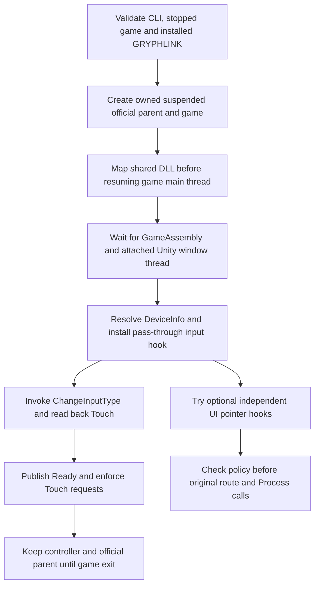

# Endfield touch UI and native pointer handling

The EF module selects the game's built-in Touch UI and applies independent
UI pointer routing for native touch. It uses the existing Windows/Unity touch
backend. Mouse conversion, platform/cloud overrides and keyboard binding
changes are not part of this implementation.

For installation and commands, see the [English](../README.md#endfield-setup-and-current-status)
or [Chinese](../README.zh-CN.md#终末地启动与验证状态) user guide. This chapter owns the
runtime contract, evidence and [manual retest cases](#manual-retest).

## Capabilities and source map

| Capability | Implementation | Success boundary |
| --- | --- | --- |
| New-game startup | [Registry/child ownership](../launcher/include/game.hpp), [launcher](../launcher/src/launcher.cpp) | Creates only a new Endfield process; rejects an already-running game |
| Official parent | [ef_parent.hpp](../games/ef/include/ef_parent.hpp) | Verifies and retains an owned installed GRYPHLINK process |
| Early payload load | [load_library_diagnostic.hpp](../common/process/include/load_library_diagnostic.hpp), [shared dispatcher](../payload/src/payload.cpp) | Expected DLL path is mapped before the game's main thread resumes |
| Touch UI selection | [ef_runtime.hpp](../games/ef/include/ef_runtime.hpp), [ef_hook.hpp](../games/ef/include/ef_hook.hpp), [window-thread pump](../games/ef/src/payload.cpp) | Reads the actual DeviceInfo input state as Touch and publishes Ready |
| Independent UI pointers | [ef_pointer.hpp](../games/ef/include/ef_pointer.hpp) | Hooks are enabled and the current callback instance's field is independently checked |

EF relies on Unity/Windows to deliver native touches. ZZZ additionally supplies
a Windows-to-Unity touch bridge; EF does not reuse that bridge. A physical
touchscreen still needs UI selection, and pointer-state handling can matter
when mouse and touch UI records interact. A streaming client must deliver
native touch, rather than only mouse emulation, to use this path.

## Entry and ownership

```powershell
./dist/TouchUILaunch.exe --EF --game 'C:/Games/Endfield/Endfield.exe' --log
```

The registry accepts `Endfield.exe` case-insensitively and requires an explicit
path. The launcher preserves the usual stopped-game guard, elevation, launch
mutex, raw extra arguments and owned-child cleanup. It detects the newest
installed `ProgramFiles/GRYPHLINK/<version>/Games.exe`; `--ef-launcher <Games.exe>`
selects a custom installation. The image must be x64, have a trusted offline
Authenticode signature, and identify its signed product as GRYPHLINK. The
actual creation repeats verification with a replacement-denying file handle.
Automatic discovery checks the root `Games.exe` and immediate numeric-version
subdirectories, ordering the latter numerically rather than alphabetically.
It is not a recursive search of all drives. Verification uses cached trust
information without online revocation checks. An explicit `--ef-launcher`
path is verified by the same rules.

An owned suspended official-launcher process supplies the Windows parent
attribute for a newly created suspended Endfield process. Existing launchers
are not injected or terminated. A kill-on-close job with silent child
breakaway tracks only this suspended parent, avoiding an abandoned parent
without putting the released game in a kill-on-close launch job.

The shared DLL is mapped through ordinary `LoadLibraryW` before the game's
main thread resumes. Its full HMODULE, module path and loader thread result
are checked. The payload then waits for normal GameAssembly/Unity startup.
There is no late injection fallback or manual mapping.



The EF session has PID-scoped `Log`, `Ready` and `Failed` events under
`Local\TouchUILaunch.EF.*`. Their presence selects the EF worker independently
of whether logging is enabled. Missing events or mixed ZZZ/NTE/EF activation
are rejected by the common dispatcher. Existing coordination objects are not
silently reused. The worker additionally requires the process to be Endfield.

The launcher waits up to 240 seconds after injection for Ready, failure or
child exit: 120 seconds for GameAssembly, then a fresh 120 seconds for UI
initialization. Ready requires real input-state confirmation. Only then does it
release ownership of the child. A failure before that point terminates only
the process created by this launch. After Ready the controller stays alive
until game exit to retain the official parent; keep the launcher running.
There is no attach or runtime disable CLI.

The launcher returns `0` after its post-Ready wait observes game exit; it does
not forward the game's exit code or certify that exit was clean. Ending the
controller early removes the retained official parent. Although `Child` no
longer terminates the released game, continued game behavior without that
parent is not an accepted mode. Keep the controller running.

## Runtime contract

[ef_runtime.hpp](../games/ef/include/ef_runtime.hpp) binds IL2CPP exports from
the loaded GameAssembly. It does not load metadata files or choose a version
profile. A domain or assembly that has not appeared is pending. Once the
Common.Beyond image is present, missing or ambiguous contracts fail explicitly.

The contract consists of:

- `Common.Beyond[.dll] / Beyond.DeviceInfo` and nested `InputType`.
- `InputType.Touch`, checked as a static enum literal with an Int32
  representation, and read dynamically through `il2cpp_field_static_get_value`.
- Static `<inputType>k__BackingField` of the same enum type.
- Static reference fields `s_provider` and `onInputTypeChanged`.
- Exactly one static `void ChangeInputType(InputType)` method. Unrelated
  overloads are ignored; matching duplicates fail.

The entry is the first pointer of Unity's MethodInfo prefix. It must be
executable MEM_IMAGE memory owned by the current GameAssembly. There is no
fallback to an RVA, another MethodInfo slot or an executable in another DLL.

## Main-thread switch and lifetime

[payload.cpp](../games/ef/src/payload.cpp) finds an owned `UnityWndClass`
window with a usable client area. Its worker schedules a 250 ms HWND timer.
USER32 dispatches the callback on the thread owning that window. The callback
checks the HWND, timer ID, thread ID and `il2cpp_thread_current()` before
resolving metadata or invoking the game. The worker never attaches to IL2CPP
and performs no managed calls. This avoids attaching an injected thread while
Unity's collector is still starting.

Once metadata resolves, [ef_hook.hpp](../games/ef/include/ef_hook.hpp) installs
a MinHook detour on `ChangeInputType`, initially as a pass-through. The pump
waits for non-null provider and notification references, reads the real input
field and uses `il2cpp_runtime_invoke` to request Touch. The game owns the
actual field update and UI notifications; this module does not write the
static field directly or fake getter results.

A managed exception or an unchanged field does not confirm the switch. The
pump retries at most four times per second. Synchronous UI event reentry is
guarded. An exception after the input field has already changed is a failure:
a matching field on the next tick cannot prove that UI notifications finished.
After a successful readback, the detour keeps subsequent requests at
Touch while forwarding the original MethodInfo and calling the original
method. The timer also repairs direct field changes from initialization.

The payload and GameAssembly are pinned before publishing callbacks. A
destroyed window can be replaced on the same attached game thread; a move to
another thread is rejected. Contract/native faults signal failure and make
the installed detour pass-through. The trampoline and DLL remain resident;
production does not unload callbacks or attempt to restore code over other
writers. A failure after Ready is logged, but cannot retroactively change the
launcher's exit status. Restart after such a failure.

## Independent UI pointer routing

The user reported intermittent menus and story choices/advance clicks showing
only mouse hover feedback, while movement, camera and team switching worked.
This is consistent with the reference's pointer-state reuse problem, but the
exact failure has not been reproducibly traced in this session.

[ef_pointer.hpp](../games/ef/include/ef_pointer.hpp) resolves
`Unity.InputSystem[.dll] / UnityEngine.InputSystem.UI.InputSystemUIInputModule`,
its instance `m_PointerBehavior` enum field, the Int32
`UIPointerBehavior.AllPointersAsIs` literal, instance `void Process()`, and
instance `int GetPointerStateIndexFor(InputControl, bool)`.

Both hooks apply AllPointersAsIs before calling the original method. The
routing entry matters because InputAction callbacks can precede the normal
UI Process pass. Arguments, MethodInfo and return values pass through unchanged.
Unity then retains independent UI records for mouse and each touch.

The implementation uses IL2CPP instance-field get/set exports on the valid
callback instance, checks the setting by readback, and retains no managed
instance across frames. It needs no fixed field offset, object scan or GC
handle table. The setting is maintained for the process lifetime. Diagnostics
for individual applications are bounded to eight reports.

Missing metadata/exports or hook conflicts leave this capability unavailable
with a diagnostic; they do not disable the independently accepted layout
switch. A field access/readback failure makes installed pointer hooks
pass-through. Partially installed hooks keep their trampolines resident.
The policy does not synthesize mouse/touch events or change gameplay bindings.

### Readiness and fallback

These are separate observations; one does not imply the next:

| Log marker | Establishes | Still requires observation |
| --- | --- | --- |
| `READY: DeviceInfo.inputType read back as Touch` | Layout state was confirmed; the controller may release game ownership | Visible UI, pointer capability and actual input |
| `UI pointer routing: independent mouse/touch policy ready` | Both optional pointer hooks were enabled | A UI instance using them and successful field application/readback |
| `UI pointer routing: AllPointersAsIs applied before input` | That callback instance changed to the resolved policy and readback matched | Menu/story clicks, drags and multi-input behavior |
| `UI pointer routing unavailable; layout selection continues` | The pointer contract or hook installation failed | The layout path may still reach Ready |
| `UI pointer routing: field access/readback failed; hooks now forward original calls` | Further field enforcement is disabled | The already-applied scalar is not rolled back; restart for another attempt |

An instance already using the independent policy produces no application log.
Reports for changed instances are bounded to eight; a missing new report after
that limit is not failure evidence. If the InputSystem assembly is still
pending, installation is retried on later layout timer ticks, including after
Ready. A contract/install error instead marks the capability unavailable for
the session. There is no public per-feature toggle or retry/reload command.

The current startup banner contains `EF touch UI only`. It predates the pointer
capability and is not a capability report; use the separate markers above.

## Reference and sample evidence

The UI interface and official-parent startup strategy follow Better-Endfield's research at
[`c33ec5e4`](https://github.com/Dr-hydra/Better-Endfield/tree/c33ec5e48742d4d543e8a4edc3607b98a0409a43),
particularly its
[mobile UI research](https://github.com/Dr-hydra/Better-Endfield/blob/c33ec5e48742d4d543e8a4edc3607b98a0409a43/docs/ui/MOBILE_UI_REVERSING.md).
It explains why changing the real input state and raising the game's event
reaches existing UI where hooking a duplicate getter may not. No upstream
implementation files were imported; this module uses local metadata
contracts, verified owned Windows process creation, native instance-field
access and the project's own window-thread and launch-lifetime design.

Pointer policy references:
[Better-Endfield's integration notes](https://github.com/Dr-hydra/Better-Endfield/blob/c33ec5e48742d4d543e8a4edc3607b98a0409a43/docs/ui/TOUCH_POINTER_REUSE_FIX.md),
their credited [orangetooth/endfield-touch-patch analysis](https://github.com/orangetooth/endfield-touch-patch/tree/55a4553a126da4efc29623d03f47e881e4f1fd0e),
and [Unity's UIPointerBehavior documentation](https://docs.unity3d.com/Packages/com.unity.inputsystem@1.4/api/UnityEngine.InputSystem.UI.UIPointerBehavior.html).
The public setting's setter writes that backing field in Unity's
[InputSystemUIInputModule source](https://github.com/Unity-Technologies/InputSystem/blob/1.4.4/Packages/com.unity.inputsystem/InputSystem/Plugins/UI/InputSystemUIInputModule.cs).

Read-only inspection of the separately preserved EF 1.5 sample on 2026-11-28
confirmed the required IL2CPP export names, DeviceInfo/input enum/field names,
and `ChangeInputType`'s state-write and notification path. Sample GameAssembly
SHA-256: `593d0b905f793e6bebd25ec3432af3f7ff0f4f0c24399ec49c3ddbb129bdc86c`.
That fingerprint is evidence only; production neither computes nor checks it.
All 23 required layout exports were found in that sample.
The two optional instance-field access exports and pointer metadata are also
present in the sample; they are checked dynamically in the actual process.
No sample binaries, addresses or parent-workspace data are required by the
standalone build or default tests.

## Verification

Use the [focused Endfield checks](TESTING.md#endfield-checks) to configure/build
the required targets and run the three EF/dispatch cases. Full verification
also checks CLI and packaging; it requires the supported games to be stopped.
Do not stop a user's active session merely to run the complete suite.

The Endfield fixtures supply their own metadata and enum value, exercise
strict rejection and pending states, test readback/retry/reentry/thread guards,
execute the actual MinHook detour, and schedule a USER32 timer from a worker
onto an owned window. The shared-DLL fixtures cover complete, conflicting and
partial EF activation plus wrong-process rejection. CLI tests cover EF path,
probe, duplicate/mixed selectors, stopped-game and payload requirements.
These checks establish fixture behavior, not a visible real-game layout.

They additionally create a real owned parent/child pair, verify the parent PID
and main-thread suspension, map the production DLL before main, and reject
incorrect process activation. The optional installed parent can be validated
without launching anything:

```powershell
./build/windows-x64-release/Release/EndfieldTests.exe --parent 'C:/Program Files/GRYPHLINK/1.6.0/Games.exe'
```

`EndfieldPointerTests` resolves a different enum value, executes the actual
MinHook callbacks, checks policy timing before the original route, exact
argument/return forwarding, multiple UI instances, bounded reports,
unattached-thread behavior, failed field readback, restart and hook conflicts.
A small pointer-record model checks release/second-finger preservation; it
does not reproduce Unity or prove the intermittent real-game bug is fixed.

Recorded verification on 2026-11-28 for the implementation committed as
`7d6290c`:

| Check | Recorded result and scope |
| --- | --- |
| Release build and package | Passed; packaged EXE/DLL matched the build outputs |
| Default CTest | 16/16 passed; EndfieldTests reported 62 checks, EndfieldPointerTests 151 |
| Payload memory boundary | Passed against the packaged DLL |
| Complete CLI suite | 240 checks passed for the official-parent startup revision before the pointer addition |
| Final-build CLI smoke | Four no-launch checks passed: help, duplicate EF selector, missing game path and active-game rejection; the complete CLI suite was not repeated while the accepted game remained running |
| Installed official parent | Read-only verification passed for signed x64 GRYPHLINK 1.6.0 Games.exe; this check does not create a parent/game |
| Optional NTE SDK-host and external GI/ZZZ/SR sample suites | Not run for this change |
| EF 1.5 sample | Read-only export/metadata analysis, separate from live acceptance |

These are results of the implementation run, not a claim that subsequent
documentation edits reran runtime checks. Menu/story improvement still needs
real-game retesting of the pointer-policy DLL.

## Diagnostics and manual acceptance

With `--log`, the payload writes `logs/ef-<game-pid>.log` beside the DLL.
The launcher also writes its normal `launcher-<launcher-pid>.log`. Pending
reports include elapsed milliseconds, the real input value, provider and
notification readiness, and actual switch attempt count. Pointer policy
resolution/application has separate bounded diagnostics.

| Last observed stage | Meaning |
| --- | --- |
| Official parent / preload | Validate installed Games.exe and map the DLL before resuming the owned game |
| Wait for GameAssembly | DLL already mapped; the child has not reached Unity initialization |
| Attached IL2CPP window thread / metadata wait | Timer has not yet reached an attached thread or Common.Beyond is not registered |
| DeviceInfo provider/notification wait | Metadata is available, but the game's device initialization is incomplete |
| Managed exception / state not confirmed | The switch has not been accepted; retries are bounded and Ready is not issued |
| READY, inputType read back as Touch | The real state matched Touch; visible HUD and input require observation |

On 2026-11-28, a late-load diagnostic recorded `phase=0` and thread status
`0xDEADC0DE`, before LoadLibrary was called. Early loading then mapped the DLL
and resolved its real metadata. Without an official parent the installed
client displayed its "start through official launcher" dialog and the device
provider remained pending. The verified parent startup path reached Ready
and the user then reported the startup/layout results below.

User acceptance for that startup/layout build:

| Behavior | Evidence |
| --- | --- |
| Touch UI selection | User confirmed normal switching |
| Movement, camera and controlled-team-member switching | User confirmed working |
| Menu controls, story choices and dialogue advance | Intermittently ineffective, with mouse-hover feedback; no stable reproduction |
| New independent pointer policy | Built/tested as a candidate fix; real-game retest pending |

The device/streaming client was not specified, so this is not a separate
physical-touch or streamed-multitouch certification. A newly built DLL is used
at the next normal launch. Scene transitions, broad menu/story coverage and
keyboard mixing still require acceptance. The reference records keyboard
binding limitations in Touch mode; this implementation does not change them.

## Manual retest

After a normal game exit, use the EXE/DLL pair from the build under test and
launch with `--log`. Record their SHA-256 values, the game build, Windows
version, device or streaming client/settings, window mode, resolution and
scaling. Check layout and pointer markers separately. An existing session
continues using its previously loaded DLL.

| Scenario | Observe and record |
| --- | --- |
| Baseline controls | Touch UI, movement, camera and controlled-member switching still work |
| Menus | Repeatedly open/close several menus; tap buttons, tabs, confirmation/cancel and list items; record hover-only or missed clicks by menu/control name |
| Story | Tap dialogue advance and each available choice; record whether a tap advances once, selects the intended option, or only highlights it |
| Contact transitions | Repeat taps, hold/release, drag/release, and two-finger sequences with both release orders; look for stuck, duplicated or lost input |
| Mouse/touch interaction | Move the mouse before/between touches; test a stationary hover and a second finger while another is held; compare with touch-only behavior |
| Focus and display | Alt-tab and return, reopen UI, and test supported window/full-screen/scaling transitions for alignment and input recovery |
| Scene transitions and keyboard | Recheck UI after loading a scene and after keyboard/mouse use; record individual binding failures rather than inferring all bindings work |
| Lifetime | Keep the controller alive, exit the game normally, observe controller/owned-parent cleanup, then start a fresh session |

For an intermittent failure, retain the launcher logs (including the elevated
PID) and `ef-<game-pid>.log`, approximate time, exact screen/control, input
sequence and attempts/failures. Include whether the pointer-ready and
application markers appeared or the capability degraded. A short recording is
useful when available. If the problem does not recur, report the cases and
number of attempts tested rather than calling it universally fixed.
